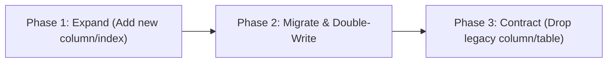

# Database Migration and Schema Evolution Strategy

This document outlines the zero-downtime database migration guidelines, the Expand/Contract pattern, shadow database requirements, and schema verification processes for AutiCare.

---

## 1. Zero-Downtime Philosophy: The Expand / Contract Pattern

Database changes must **never break currently running instances of the application**. Because deployments occur as rolling updates where the old version and new version coexist for a period of time, all migrations must follow the three-phase **Expand / Contract pattern**:



### Phase 1: Expand

- Add new columns as **nullable** or with safe **default values**.
- Add new tables or indexes concurrently.
- Never rename or drop existing columns or tables in this phase.
- Both the old version and the new version of the API can run safely.

### Phase 2: Dual-Read/Write & Backfill

- Application code writes to both old and new columns, or reads new columns with fallback to old columns.
- Background backfill scripts migrate legacy records to the new format.

### Phase 3: Contract

- Once all deployed instances run the new code and backfills are 100% complete, a subsequent migration drops the legacy column, table, or constraint.

---

## 2. Shadow Database Requirements

Prisma requires a separate "shadow database" when generating and testing migrations (`prisma migrate dev`).
In local development and CI:

- The script `scripts/ensure-shadow-db.mjs` automatically creates `auticare_shadow` using the configured database credentials.
- In production, migrations are deployed strictly using `prisma migrate deploy`, which does **not** require a shadow database and executes only unapplied migration files in chronological sequence.

---

## 3. Production Migration Deployment Workflow

1. **Local Authoring & Shadow Database Test**:
   ```bash
   pnpm db:shadow
   pnpm db:migrate
   ```
2. **Schema Drift Verification**:
   CI ensures that `schema.prisma` matches the migration history:
   ```bash
   node scripts/check-migration-drift.mjs
   ```
3. **Dry-Run Inspection Before Production Execution**:
   ```bash
   pnpm --filter @auticare/api db:deploy --dry-run
   ```
4. **Execution in Production**:
   Executed as a dedicated pre-deploy container step:
   ```bash
   docker compose -f docker-compose.prod.yml run --rm api pnpm --filter @auticare/api db:deploy
   ```

---

## 4. Reversible Migration Rules

Every migration must be authored with a reversal plan:

- Alongside `migration.sql`, document or test the corresponding inverse operation.
- **Index addition**: Can be reversed with `DROP INDEX index_name ON table_name;`.
- **Foreign keys / Unique constraints**: Can be dropped with `ALTER TABLE table_name DROP FOREIGN KEY constraint_name;`.
- **Column drops**: Cannot be reversed without data loss! Hence, columns must only be dropped in Phase 3 after data is verified in the new structure.
